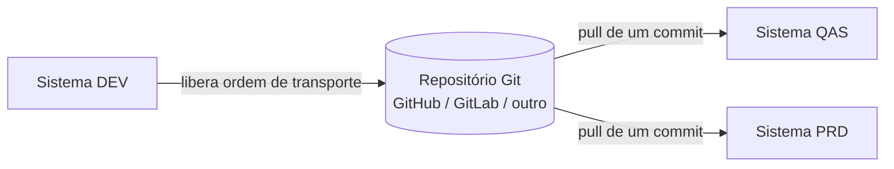

# SAP gCTS - Study

> Nível: noção
> Leitura, sem prática no trial: o Git-enabled Change and Transport System e como ele se relaciona
> com o abapGit e o transporte clássico. Relacionados: [abapGit-devops-study](https://github.com/igor-barral/abapGit-devops-study),
> [SAP-BTP-ABAP-Environment-devops-study](https://github.com/igor-barral/SAP-BTP-ABAP-Environment-devops-study).

## Objetivo

O **gCTS** (*Git-enabled Change and Transport System*) é a solução oficial da SAP para ligar o
sistema de transporte ABAP (CTS) a repositórios Git. Enquanto o abapGit é um projeto open source
voltado a versionar e compartilhar código, o gCTS nasce do lado do **transporte**: registra em Git
as alterações liberadas em ordens de transporte e usa esse repositório para distribuir as mudanças
entre sistemas do *landscape*.

Este repositório é só leitura: o gCTS depende de configuração administrativa em sistemas
on-premise, o que não existe no BTP trial. O objetivo é reconhecer o termo numa vaga ou
entrevista e saber posicioná-lo.

Ao concluir este estudo você deverá ser capaz de responder perguntas como:

- O que é o gCTS e que problema ele resolve?
- Qual a diferença entre gCTS e abapGit?
- Quando um cliente usa um, o outro ou os dois?
- Onde o gCTS aparece no BTP ABAP Environment?

## Ponte

| O que eu já conheço | No gCTS |
|---|---|
| GitOps: o repositório Git dirige o que está em cada ambiente | Repositório Git ligado ao transporte; sistemas de destino fazem *pull* de commits |
| Pipeline que promove um artefato de *staging* para produção | Rotas de transporte DEV → QAS → PRD, agora com Git no meio |
| Branch por ambiente ou por release | Branches e commits associados a ordens de transporte |
| Auditoria de deploys | O CTS continua registrando o que foi importado em cada sistema |

## Conteúdo

### Como funciona, em linhas gerais

- Um **repositório gCTS** é configurado no sistema ABAP e vinculado a um repositório remoto.
- Ao **liberar** uma ordem de transporte no sistema de desenvolvimento, o conteúdo é gravado como
  commit no repositório.
- Os sistemas de destino atualizam para um commit específico, o que leva as mudanças para lá.
- A configuração e o acompanhamento são feitos por um aplicativo Fiori de gCTS e por APIs, o que
  permite integrar com pipelines de CI/CD.
- A disponibilidade e os pré-requisitos (versão do ABAP Platform, componentes técnicos,
  configuração de certificados e usuários) variam por versão; confirme na documentação do seu
  release antes de planejar um uso real.

### gCTS e abapGit

| Ponto | abapGit | gCTS |
|---|---|---|
| Origem | Open source, comunidade | Produto SAP, suporte oficial |
| Foco | Versionar e compartilhar código de um pacote | Transporte de mudanças entre sistemas via Git |
| Unidade de trabalho | Pacote ABAP | Ordens de transporte ligadas a um repositório |
| Onde roda | ECC, S/4HANA, BTP ABAP Environment, S/4HANA Cloud | Sistemas ABAP on-premise em versões que o suportam; base técnica de recursos do BTP ABAP Environment |
| Formato dos arquivos | Formato abapGit (`.abap` + `.xml`) | Definido pela configuração do repositório gCTS, que varia por versão; não trate os dois como intercambiáveis sem verificar |
| Uso típico | Projetos open source, backup de código, revisão, portabilidade entre sistemas | Governança de transporte com Git em landscapes de cliente |

### Onde cada um aparece

- **Cliente on-premise tradicional**: CTS clássico (ordens de transporte e STMS). Pode usar abapGit
  para versionar e revisar código e, se decidir modernizar o transporte, adotar gCTS.
- **Cliente que quer CI/CD de ABAP**: gCTS para a promoção entre sistemas, às vezes com abapGit ao
  lado para compartilhar bibliotecas open source.
- **BTP ABAP Environment**: o transporte entre sistemas é feito por **componentes de software**
  administrados em aplicativos como *Manage Software Components*, com tecnologia baseada em Git e
  gCTS operada pela SAP. O desenvolvedor não configura gCTS diretamente; usa o abapGit (plugin ADT)
  para trazer ou publicar código em repositórios próprios.
- **Portfólio pessoal (este roadmap)**: só abapGit. O gCTS entra como conhecimento de contexto.

## Respostas

**O que é o gCTS e que problema ele resolve?**
É a integração oficial da SAP entre o sistema de transporte ABAP e o Git. Resolve a falta de
histórico Git e de automação no transporte clássico, permitindo que a promoção de mudanças entre
sistemas seja dirigida por commits e integrada a pipelines.

**Qual a diferença entre gCTS e abapGit?**
O abapGit é um cliente Git open source que versiona o conteúdo de um pacote e não interfere no
transporte. O gCTS é um produto SAP ligado ao transporte: grava ordens de transporte em Git e usa o
repositório para distribuir mudanças entre sistemas, com suporte oficial.

**Quando um cliente usa um, o outro ou os dois?**
abapGit quando o objetivo é versionar, revisar ou compartilhar código (inclusive bibliotecas open
source); gCTS quando o objetivo é governar o transporte com Git e automatizar a promoção entre
ambientes; os dois quando o cliente transporta com gCTS e consome ou publica código com abapGit.
Muitos clientes ainda usam só o CTS clássico.

**Onde o gCTS aparece no BTP ABAP Environment?**
Como base técnica do transporte de componentes de software, operada pela SAP. O desenvolvedor não o
configura diretamente.

## Referências

- SAP Help Portal: https://help.sap.com (buscar "Git-enabled Change and Transport System" e
  "Manage Software Components").
- SAP Community: https://community.sap.com (buscar "gCTS" para os blogs de introdução e as
  comparações com abapGit).
- abapGit: https://abapgit.org e [abapGit-devops-study](https://github.com/igor-barral/abapGit-devops-study).
